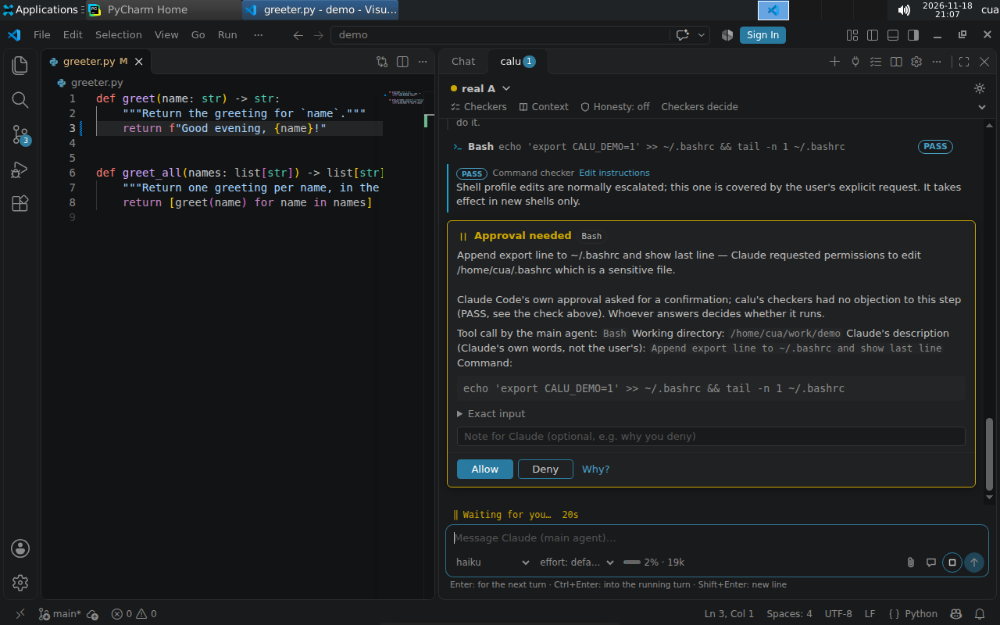
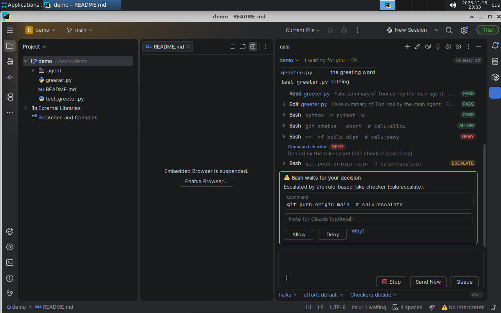

# Calu

[](https://github.com/kadeng/calu/actions/workflows/checks.yml)

> **Ed Dillinger:** "What's the project you're working on?"
>
> **Alan Bradley:** "Well, it's called Tron. It's a security program itself, actually. It
> monitors all contacts between our system and other systems. It finds anything going on
> that's not scheduled, it shuts it down. I sent you a memo on it."
>
> **Ed Dillinger:** "Part of the Master Control Program?"
>
> **Alan Bradley:** "No, it'll run independently. It can watchdog the MCP as well."
>
> — *Tron* (1982), [quotes on IMDb](https://www.imdb.com/title/tt0084827/quotes/)

## Stay in control of your coding agent, even in auto mode

**The problem.** A coding agent produces steps faster than a person can read them. Left
unwatched it drifts from the task, and a wrong step costs more the later it is caught.

**What Calu does.** It runs [Claude Code](https://claude.com/claude-code) and puts **independent 
agents** (checker agents) in charge that need to approve (and can comment to Claude about) every command and
every edit: small models that follow instructions you write and interpret them in the context
of your chat session.

These checker agents focus on a much narrower task than your main coding agent. They can only read
and decide, never act or write on their own. They are much better at keeping your instructions
in mind at all times.

>
> Is this not just what "Auto" approval mode does? 
>

*Yes and no. Auto-approval is very generic and stops generally unsafe actions. While it adapts a bit to your
stated intent ( e.g. to what you write in the LLM chat), it will not remember your custom instructions over
longer timespans or sessions. It will stop generally unsafe actions like uploading your SSH keys to a
remote server. It won't stop your agent from writing "load-bearing" in every third sentence, it won't steer your
coding model to behave like you want it to. And it can be tricked by deception (dishonest code).*

What this gives you is much more control over what happens. These agents are faster than
your coding agent, and they look at what happens from multiple angles.

- **Security and Confidentiality.** You can give your own standing instructions about which commands
should be approved automatically, what is off limits, and what needs your approval. The
regular Claude auto mode is very generic in this sense; Calu leaves general safety to it, so
  switch it on (Getting started below). Your instructions, the settings and the record of every
  step are in a database the session cannot write; the checkers can only read, and only inside
  the project. Claude's own words reach them only retold by a narrator, so an instruction
  planted in a web page arrives as a report that someone wrote it. With `--sudo`, Claude Code
  runs as a different user than Calu and cannot approve its own steps.
- **Honesty enforcement.** Calu (optionally) tracks incrementally whether names and documentation say what the
  code does, and can keep code that is not verified yet from being run or committed. This
prevents an agent sneakily avoiding supervision by placing things that you don't want to happen
in harmless-looking code sections. *(Sounds far-fetched? I saw DeepSeek V4 do this and hide its
tracks afterwards. Even well-aligned SOTA models can misunderstand conflicting goals, fail to remember rules
or misunderstand priorities.)*



> **Flynn:** "Who's that guy?"
>
> **Program:** "That's Tron. He fights for the Users."
>
> — *Tron* (1982)

Steer while it happens with your instructions, modifiable at any time, via a friendly UI right in your IDE, terminal or browser.

- **Keep it readable by humans.** Stop bad agentic writing styles before they take hold.
- **Stop overengineering right there.** A checker sees a change before it lands and can send
  it back: an abstraction nobody asked for, work beyond the task, a test weakened to pass.
- **Your repo, your rules.** You have custom confidentiality rules or writing style that you want
maintained at all times? Don't let violations happen. 
- **More autonomy where you trust it, less where you don't.** If auto mode keeps asking about
  something you always approve, tell a checker to allow it, and the step runs without a
  prompt. If auto mode lets something through that you want to see first, tell a checker to
  ask, and the session waits for you.
- **Keep your data and secrets confidential.** You have certain data or secrets that may not be mishandled, and
the coding agent has a hard time remembering the specifics with all the other things it does? Have
additional eyes watch this.

### Participate actively in the coding process, delegate micromanagement

> **Dr. Walter Gibbs:** "Computers and programs will start thinking, and the people will stop."
>
> — *Tron* (1982)

- **You are not a bystander. Contribute and modify your instructions whenever you like, review and contribute
at every level of detail you want.** Having checker agents help with the micromanagement
frees your attention to actually look at what is really happening, which in turn allows you to
engage intellectually with what matters, not with micromanagement and babysitting a coding agent.
- **Version control and review the redacted LLM chat history along with the code changes.** A session
  can be written step by step as Markdown into the project, with secrets and personal data
  replaced, and committed and reviewed with the change it produced. Chat logs are more and more
going to be the highest-level description of the specifications that went into a project. They,
just like source code, may need review.
- **Run a herd of agents and stay in control of it.** The web interface lists every session
  on every machine, those that wait for a decision first, with each one's history, diffs and
  live view. 

Claude Code itself is unchanged underneath: its tools, permission rules, auto mode, plugins,
MCP servers, skills and subagents work as your project configures them.


> **Dr. Walter Gibbs:** "That MCP, that's half our problem right there."
>
> **Ed Dillinger:** "The MCP is the most efficient way of handling what we do! I can't sit
> here and worry about every little user request that comes in!"
>
> **Dr. Walter Gibbs:** "User requests are what computers are for!"
>
> — *Tron* (1982)


## Frontends - Terminal UI, Web UI, IDE extensions

Calu wraps Claude Code. For convenience, it replaces most of the user interface you are used to. But
don't worry, it has what you expect from a full-fledged coding assistant. And it does not
replace the proven Claude Code harness itself, it sits on top of it.

Claude Code sessions run independently of the frontend. You can detach and attach to sessions
and switch user interfaces or even use multiple of them in parallel.

- **VSCode extension** ([extensions/vscode](extensions/vscode)): the chat on the right;
  checker instructions, checker context and honesty one click away; a click on an edit opens
  its diff, a click on a file name opens the file at the line; a settings dialog with one
  model for every role. Meant to run where the workspace is (WSL, SSH, a dev container).
- **PyCharm plugin** ([extensions/jetbrains](extensions/jetbrains)), for PyCharm 2026.3: the
  same chat as a native tool window, in three modes: everything local; JetBrains'
  remote development with the IDE backend on the server; a local IDE on a copy that Calu keeps
  in sync with the server over SSH, with run and debug through PyCharm's SSH interpreter
  ([guide](CALU_GUIDE.md#pycharm-the-three-ways-to-work)).
- **Web interface** (`calu web`): all sessions of all machines, history, diffs, a live view,
  settings, herd management.
- **Terminal** (`calu attach`): a full-screen client, and a line client for pipes. It and the
  web interface also work from another machine through SSH
  ([guide](CALU_GUIDE.md#from-another-machine)).
- **ACP editors** (`calu acp`): Zed, Neovim, JetBrains' agent chat.
- **Command line on the database**: `calu sessions`, `calu escalations`,
  `calu resolve 12 allow`.

<p>



</p>


## Getting started

You need Linux where Claude Code runs (clients may be anywhere), Python 3.14 with
[uv](https://docs.astral.sh/uv/), Claude Code set up for your project, PostgreSQL (see below)
and credentials for the checker models.

**Calu needs a PostgreSQL database.** Either a central server (your own, or RDS) that several
machines share, or a local one that `calu setup` runs in Docker on the machine where `calu
serve` or `calu run` runs (that variant needs Docker installed there). It holds your messages, every step with its command or edit, the
checkers' summaries and decisions, the settings and the checker instructions. That record can
contain code, secrets the agent came across and personal data: protect, back up and upgrade
the database like any other that holds sensitive data.
([The database](CALU_GUIDE.md#the-database))

Claude Code's own sandbox is optional; `calu setup` asks whether to switch it on (it needs
`bubblewrap` and `socat`).

```bash
uv tool install git+https://github.com/kadeng/calu   # one package, every command
calu doctor               # what is in place and what is missing
calu setup                # picks or creates the database; asks for two passwords
```

The checkers need a key of their own, which Claude Code never sees. By default every role uses
Claude Haiku on the Anthropic API:

```bash
echo 'ANTHROPIC_API_KEY=sk-ant-...' >> ~/.config/calu/.env
calu config models auto                          # or pick one model for every role
calu config set claude.require_auto_mode true    # the checkers rely on auto mode
```

Register the project and start working:

```bash
calu project add . --name demo        # also sets what its commands may reach on the network
calu run -p "fix the failing test"    # one session, here, in the foreground
```

`calu run` and `calu serve` print only what needs your attention; the conversation is in the
clients. For more than one session, keep a server running and ask it:

```bash
tmux new-session -A -s calu 'calu serve'   # detach with Ctrl-B D; it keeps running
calu start                                 # a session in this directory, attached
calu attach                                # the full-screen client on the session here
calu web                                   # prints the address of the web interface
```

**The VSCode extension** is not on the marketplace yet. Build it and install the file:

```bash
cd extensions/vscode && npm ci && npm run package   # writes calu.vsix
```

Then "Extensions: Install from VSIX…" in VSCode 1.106 or newer. It finds `calu` itself, offers
to install uv and Calu where they are missing, tells you how to start a server if none
answers, and checks that Claude Code is there (it does not install it).

**Running the agent as a user that cannot touch Calu.** With `--sudo`, Calu runs as root and
Claude Code as you, so nothing the agent starts can read Calu's credentials or approve its own
steps: `calu serve --sudo`, `calu attach --sudo`.
([Calu as root](CALU_GUIDE.md#calu-as-root-claude-code-as-another-user)) If you would rather
have no passwords at all on a machine that is yours alone, `sudo calu setup --no-password`
does that, and says plainly what it gives up.

Then write your rules and see whether the checkers follow them:

```bash
calu checker edit command    # the command checker's instructions, in $EDITOR
calu evals                   # the checkers against the built-in cases
```

## Full Documentation

[CALU_GUIDE.md](CALU_GUIDE.md) is the documentation: every command, credentials, the sandbox
and network policy, remote access, the front ends, checkers and rules. Every setting with its
type and default is in [docs/CONFIGURATION.md](docs/CONFIGURATION.md). The decisions behind it
all are in [agent/records/PLAN.md](agent/records/PLAN.md); how it is tested, including the tests driven by screenshot
in a container, in [docs/TESTING.md](docs/TESTING.md) and
[agent/records/notes/test-plan.md](agent/records/notes/test-plan.md). Contributing starts at
[AGENTS.md](AGENTS.md).

## Free software under the GPL licence, usable in any project, including commercial or closed source

GPL-2.0 ([LICENSE](LICENSE)), for **Calu itself**: it is free software and stays free
software, and a fork you distribute stays GPL-2.0 too.

It says nothing about what you build with Calu. It is a tool you run, like a compiler: your
repository can be closed, commercial or under any licence, and code written with Calu's help
is yours. Your checker instructions and rules are your own text, and what Calu produces as it
runs carries no licence condition.

The checker instructions **shipped with Calu** are not under the GPL: they are prompts, meant
to be copied and rewritten, and are placed in the public domain as far as the law allows.
[LICENSE.md](LICENSE.md) has the wording.

Calu comes with **no warranty of any kind**. A checker is a language model reading a step,
not a promise that nothing bad gets through.
