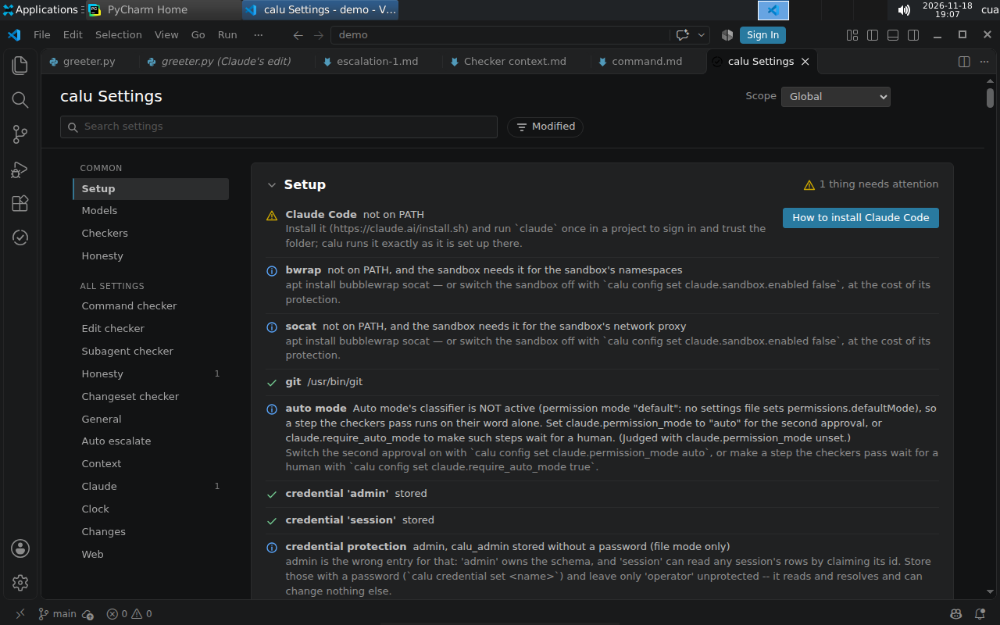

# calu

[](https://github.com/kadeng/calu/actions/workflows/checks.yml)

> **Flynn:** "Who's that guy?"
> **Program:** "That's Tron. He fights for the Users."
>
> — *Tron* (1982)

## Stay in control of Claude Code

**The problem.** A coding agent produces steps faster than a person can read them. Left
unwatched it drifts from the task, and a wrong step costs more the later it is caught.

**What calu does.** It runs [Claude Code](https://claude.com/claude-code) and puts **checker
agents** in front of every command and every edit: small models that follow instructions you
write. Most steps pass. Where Claude drifts, the checker says so and Claude corrects course.
Where a person has to decide, the session waits until one does, from any front end.
Afterwards every step is on record.

- **Security.** A step is judged before it runs, by Claude Code's auto mode and by the
  checkers. A step that needs a person stops the session until someone answers. The rules and
  the record are in a database the session cannot write; with `--sudo` the agent runs as a
  different user than calu.
- **Honesty.** calu tracks, file by file, whether names and documentation still say what the
  code does, and can keep unverified code from being run or committed.

What you can do with it, if you want to:

- **Stop overengineering right there.** A checker sees a change before it lands and can send
  it back: an abstraction nobody asked for, work beyond the task, a test weakened to pass.
- **Your repo, your rules.** The instructions are yours, in Markdown, stored where the session
  cannot change them.
- **Honest and readable docs at every step.** Names, docstrings and comments can be checked
  with each edit instead of at the end of the task.
- **You are not a bystander. Contribute whenever you like and review at every level of
  detail.** Send a message into the running turn or queue one for the next; read one line per
  step, the step's diff, the conversation as the checkers see it, or the whole session as a
  file in the repository.

Claude Code itself is unchanged underneath: its tools, permission rules, auto mode, plugins,
MCP servers, skills and subagents work as your project configures them.


## What calu adds to Claude Code

The agent and the chat are Claude Code's: images, rewind, fork, several sessions, slash
commands, model and thinking level, context usage, questions, approvals, notifications. calu
adds:

| Area | What calu adds |
|---|---|
| Judging a step | Besides Claude Code's own rules and auto mode: checkers that apply your rules, on a model and provider you choose |
| A step that needs a person | The session pauses; the answer can come from VSCode, PyCharm, the browser, a terminal or the database, on any machine |
| Where a session lives | On a server (`calu serve`); front ends attach and detach, several at once; the session continues with none attached |
| Several sessions, several machines | One overview of all of them, those that wait for a decision first |
| Subagents | A tab each, with task and result; messages to a background subagent; its open decisions shown in every view |
| The record | Every step with the checker's summary in PostgreSQL; optionally the conversation as redacted Markdown in the repository |
| Names and docstrings | Tracked per file whether they match the code; unverified code can be kept from running or being committed |
| Separation from the agent | With `--sudo`, calu runs as root and Claude Code as the user, so the agent cannot read calu's credentials or decide its own approvals |
| The rules | Markdown instructions in a database the session cannot write, editable from every front end |

**Status: early.** What has and has not been tested is listed in [HANDOFF.md](HANDOFF.md).
Not on PyPI yet. calu succeeds
[stay-in-the-loop](https://github.com/kadeng/stay-in-the-loop).

## The parts

- **VSCode extension** ([extensions/vscode](extensions/vscode)): the chat on the right;
  checker instructions, checker context and honesty one click away; a click on an edit opens
  its diff, a click on a file name opens the file at the line. Runs where the workspace is:
  WSL, SSH, a dev container.
- **PyCharm plugin** ([extensions/jetbrains](extensions/jetbrains)), in progress: the same
  chat as a native tool window, for JetBrains' remote development and for a local IDE that
  reaches the server over SSH and syncs files through calu.
- **Web interface** (`calu web`): all sessions of all machines, history, diffs, a live view,
  settings.
- **Terminal** (`calu attach`): a full-screen client, and a line client for pipes.
- **ACP editors** (`calu acp`): Zed, Neovim, JetBrains' agent chat.
- **The database alone**: `calu sessions`, `calu escalations`, `calu resolve 12 allow`.
- **Session traces**: `traces.enabled` appends every step to
  `.agent/traces/<date>/<user>/session_NNN.md`, with secrets and personal data replaced.
  ([guide](CALU_GUIDE.md#session-traces-the-conversation-as-a-reviewable-file))
- **Code honesty**: which code was verified to say what it does, file by file.
  ([guide](CALU_GUIDE.md#code-honesty-enforcement))
- **One model for every role** in one step, with presets for Anthropic, AWS Bedrock, Fireworks,
  Mistral, or your Claude Code account without an API key.




## Pair programming instead of watching silently or babysitting

> **Alan Bradley:** "It's called Tron. It's a security program itself, actually. It monitors
> all contacts between our system and other systems. Finds anything going on that's not
> scheduled, it shuts it down. … It'll run independently and watchdog the MCP as well."
>
> — *Tron* (1982)

Before a step runs, a checker reads it with a condensed view of the conversation and answers:
nothing to say, go ahead with a remark, don't (Claude is told why), or a person should look.

- **Two opinions that fail differently.** Auto mode knows what is generally dangerous; your
  checkers know your project. The shipped checker instructions are short and leave general
  safety to auto mode, so switch it on: `calu config set claude.require_auto_mode true`. calu
  warns at every start while it is off.
- **Claude's words reach a checker as hearsay**, retold by a narrator in indirect speech, so
  an instruction planted in a web page arrives as a report that someone wrote it.
- **The rules are out of the session's reach**: instructions, settings and the record are in
  PostgreSQL behind a login the session does not have. Checkers can only read, and only inside
  the project.

Checkers are for what a linter cannot see: scope creep, over-engineering, a test weakened to
pass, a commit that does not match its message.
([What you can enforce](CALU_GUIDE.md#what-you-can-enforce-with-a-checker))

```
   VSCode · PyCharm · browser · terminal · ACP editors
        │ calu ide (bridge) or WebSocket, JSON-RPC
   calu session process  ──────────────►  PostgreSQL
        │ (checkers, rules, escalations)    settings, checker instructions,
   Claude Code                              every step, open decisions
        │
   Claude Code's own sandbox, configured by calu
```

## Getting started

You need Linux where Claude Code runs (clients may be anywhere), Python 3.14 with
[uv](https://docs.astral.sh/uv/), Claude Code set up for your project, PostgreSQL (calu can
start one in Docker, or use a server or RDS you have), credentials for the checker models, and
`bubblewrap` and `socat` for the sandbox.

```bash
uv tool install git+https://github.com/kadeng/calu   # one package, every command
calu doctor               # what is in place and what is missing
calu setup                # picks or creates the database; asks for two passwords
```

The checkers need a key of their own, which Claude Code never sees. By default every role uses
Claude Haiku on the Anthropic API:

```bash
echo 'ANTHROPIC_API_KEY=sk-ant-...' >> ~/.config/calu/.env
calu config models auto                          # or pick one model for every role
calu config set claude.require_auto_mode true    # the checkers rely on auto mode
```

Register the project and start working:

```bash
calu project add . --name demo        # also sets what its commands may reach on the network
calu run -p "fix the failing test"    # one session, here, in the foreground
```

`calu run` and `calu serve` print only what needs your attention; the conversation is in the
clients. For more than one session, keep a server running and ask it:

```bash
tmux new-session -A -s calu 'calu serve'   # detach with Ctrl-B D; it keeps running
calu start                                 # a session in this directory, attached
calu attach                                # the full-screen client on the session here
calu web                                   # prints the address of the web interface
```

**The VSCode extension** is not on the marketplace yet. Build it and install the file:

```bash
cd extensions/vscode && npm ci && npm run package   # writes calu.vsix
```

Then "Extensions: Install from VSIX…" in VSCode 1.106 or newer. It finds `calu` itself, offers
to install uv and calu where they are missing, tells you how to start a server if none
answers, and checks that Claude Code is there (it does not install it).

**Running the agent as a user that cannot touch calu.** With `--sudo`, calu runs as root and
Claude Code as you, so nothing the agent starts can read calu's credentials or approve its own
steps: `calu serve --sudo`, `calu attach --sudo`.
([calu as root](CALU_GUIDE.md#calu-as-root-claude-code-as-another-user)) If you would rather
have no passwords at all on a machine that is yours alone, `sudo calu setup --no-password`
does that, and says plainly what it gives up.

Then write your rules and see whether the checkers follow them:

```bash
calu checker edit command    # the command checker's instructions, in $EDITOR
calu evals                   # the checkers against the built-in cases
```

## Where to go next

[CALU_GUIDE.md](CALU_GUIDE.md) is the documentation: every command, credentials, the sandbox
and network policy, remote access, the front ends, checkers and rules. Every setting with its
type and default is in [docs/CONFIGURATION.md](docs/CONFIGURATION.md). The decisions behind it
all are in [PLAN.md](PLAN.md); how it is tested, including the tests driven by screenshot
in a container, in [docs/TESTING.md](docs/TESTING.md) and
[docs/notes/test-plan.md](docs/notes/test-plan.md). Contributing starts at
[AGENTS.md](AGENTS.md).

## License

GPL-2.0 ([LICENSE](LICENSE)), for **calu itself**: it is free software and stays free
software, and a fork you distribute stays GPL-2.0 too.

It says nothing about what you build with calu. It is a tool you run, like a compiler: your
repository can be closed, commercial or under any licence, and code written with calu's help
is yours. Your checker instructions and rules are your own text, and what calu produces as it
runs carries no licence condition.

The checker instructions **shipped with calu** are not under the GPL: they are prompts, meant
to be copied and rewritten, and are placed in the public domain as far as the law allows.
[LICENSE.md](LICENSE.md) has the wording.

calu comes with **no warranty of any kind**. A checker is a language model reading a step,
not a promise that nothing bad gets through.

> **Dr. Walter Gibbs:** "Computers and programs will start thinking, and the people will stop."
>
> — *Tron* (1982)
