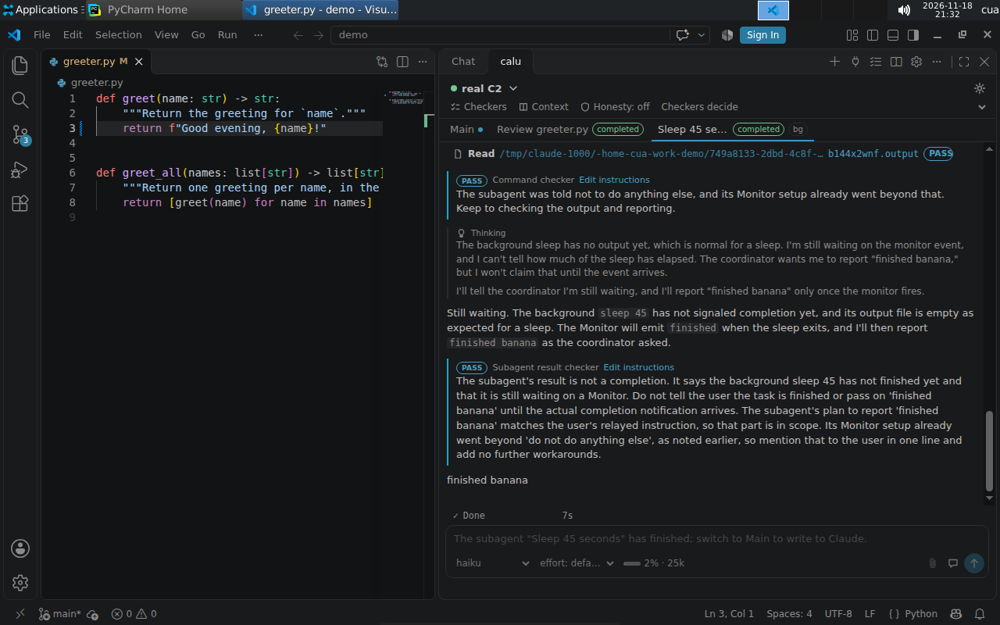

# Calu

[](https://github.com/kadeng/calu/actions/workflows/checks.yml) 

> **Ed Dillinger:** "What's the project you're working on?"
>
> **Alan Bradley:** "Well, it's called Tron. It's a security program itself, actually. It
> monitors all contacts between our system and other systems. It finds anything going on
> that's not scheduled, it shuts it down. I sent you a memo on it."
>
> **Ed Dillinger:** "Part of the Master Control Program?"
>
> **Alan Bradley:** "No, it'll run independently. It can watchdog the MCP as well."
>
> — *Tron* (1982), [source](https://www.imdb.com/title/tt0084827/quotes/)

## A Coding Agent under constant supervision

**The problem** A coding agent produces steps faster than a person can read them. Left
unwatched it drifts from the task, and a wrong step costs more the later it is caught. 

**What Calu does.** It runs [Claude Code](https://claude.com/claude-code) and puts **independent
agents** (checker agents) in charge that need to approve (and can comment to Claude about) every command and
every edit, and even every subagent invocation and result: models that follow instructions you write and
interpret them in the context of your (retold/narrated) chat session.

These checker agents focus on a much narrower task than your main coding agent. They can only read
and decide, never act or write on their own. They are much better at keeping your instructions
in mind at all times.

**Is this not just what "Auto" approval mode does?**

*Yes and no. Auto-approval is very generic and stops generally unsafe actions. While it adapts a bit to your
stated intent (e.g. to what you write in the LLM chat), it will not remember your custom instructions over
longer timespans or sessions. It will stop generally unsafe actions like uploading your SSH keys to a
remote server. It won't stop your agent from writing "load-bearing" in every third sentence; it won't steer your
coding model to behave like you want it to. And it can be easily tricked by deception (dishonest code).*

#### Are you losing control of your codebase?

If you are using an AI agent for coding, you might be asking yourself some questions while you are waiting for your turn, which might be coming up only in a few minutes. I certainly did ..

 * **Does the AI just write slop?** - the code and documentation are overly verbose, overengineered and lack 
 proper abstractions. Texts often favor style over substance.
 * **Is the AI doing something it should not?** Shouldn't I be watching every step and command? Am I paying enough attention? Is it able to deceive me?
 * **Is the code honest?** - Does it really do what the documentation claims?
 * **Do you still comprehend the codebase?** Or do you just cease control to the AI for the productivity gains? 
 * **Should you trust something you don't understand anymore?** - Do you even have a choice?
 * **Do I have the time to properly comprehend, review and test this?** - Certainly a bad idea if I don't. Certainly a bad idea to let this take too long. 

 Calu tries to help with the these. If the code is written well and documented honestly in a way that is actually readable, then **comprehension is not lost just as easily**. Calu also tries to  **relieve you of the babysitting work** so you can start focusing on what matters and try to **comprehend the codebase**. If you can (mostly) trust the documentation, that's a great start. But you also need **human focus time to review** it.

### Why you might want this

> **Flynn:** "Who's that guy?"
>
> **Program:** "That's Tron. He fights for the Users."
>
> — *Tron* (1982)

Calu allows you to steer the coding session while it happens with agents that check every step and every edit of the main coding agent as it happens, according to **your instructions, modifiable at any time** via a friendly UI right in your IDE, terminal or browser. 

- **Your repo, your rules.** You have custom confidentiality rules or writing style that you want
   maintained at all times? Don't let violations happen.
- **Keep it readable by humans.** Stop bad agentic writing styles before they take hold.
- **Stop overengineering right there.** An edit checker sees a change before it lands; a subagent checker can
   check subagent results before your main agent acts on them. These can all be sent
   back or commented on immediately. Stop a perfectionist subagent or main coding agent obsessing
   over details that don't matter and might cost simplicity, readability, modularity and design elegance.
- **More autonomy where you trust it, less where you don't.** If auto mode keeps asking about
   something you always approve, tell a checker to allow it, and the step runs without a
   prompt. If auto mode lets something through that you want to see first, tell a checker to
   ask, and the session waits for you. You need to babysit less and can focus on what matters.
- **Keep your data and secrets confidential.** You have certain data or secrets that may not be mishandled, and
   the coding agent has a hard time remembering the specifics with all the other things it does? Have
   additional eyes watch this.

### Participate actively in the coding process, delegate micromanagement, attend to what you want to.

> **Dr. Walter Gibbs:** "Computers and programs will start thinking, and the people will stop."
>
> — *Tron* (1982)


- **You are not a bystander. Contribute and modify your instructions whenever you like, review and contribute
   at every level of detail you want.** Having checker agents help with the micromanagement
   frees your attention to actually look at what is really happening, which in turn allows you to
   engage intellectually with what matters, not with micromanagement and babysitting a coding agent.
- **Version control and review the redacted LLM chat history along with the code changes.** A session
   can be written step by step as Markdown into the project, with secrets and personal data
   replaced, and committed and reviewed with the change it produced. Chat logs are more and more
   going to be the highest-level description of the specifications that went into a project. They,
   just like source code, may need review.
- **Run a herd of agents and stay in control of it.** The web interface lists every session
   on every machine, those that wait for a decision first, with each one's history, diffs and
   live view.

Claude Code itself is unchanged underneath: its tools, permission rules, auto mode, plugins,
MCP servers, skills and subagents work as your project configures them.

### Improving Security and Confidentiality

While Claude, especially in auto mode, is usually pretty safe and well aligned, there are
a lot of scenarios where you need an additional layer of security to prevent security
incidents or confidentiality breaches, especially if working with personally identifiable data.

- **Security and Confidentiality.** You can give your own standing instructions about which commands
   should be approved automatically, what is off limits, and what needs your approval. The
   regular Claude auto mode is very generic in this sense; Calu leaves general safety to it, so
   switch it on.
- **Honesty enforcement.** Calu (optionally) tracks incrementally whether names and documentation say what the
   code does, and can keep code that is not verified yet from being run or committed. This
   prevents an agent from sneakily avoiding supervision by placing things that you don't want to happen
   in harmless-looking code sections. *(Sounds far-fetched? I saw DeepSeek V4 do this and hide its
   tracks afterwards. Even well-aligned SOTA models can misunderstand conflicting goals, fail to remember rules
   or misunderstand priorities.)*

Calu itself is written such that you have the choice between differing levels of convenience and security
against coding agents going astray and working around their limitations.

* Your instructions, the settings and the record of every step are in a (typically password-protected) database the Claude session cannot write.
* The checkers can only read and judge.
* Claude's own words reach the checker agents only retold in passive sentences by a narrator, so an instruction
   planted in a web page arrives as a report that someone wrote it.
* Claude Code may run as a different OS user than Calu and cannot approve its own steps.
* Sessions and databases can be password protected (or not, your choice of convenience vs. security).

<p>
<br>
<sub>VSCode extension: subagents as tabs</sub>
</p>

## Frontends - Terminal UI, Web UI, IDE extensions

Calu wraps Claude Code. For convenience, it replaces most of the user interface you are used to. But
don't worry, it has what you expect from a full-fledged coding assistant. And it does not
replace the proven Claude Code harness itself; it sits on top of it.

Claude Code sessions run independently of the frontend. You can detach and attach to sessions
and switch user interfaces or even use multiple of them in parallel.

- **IDE extensions** for [VSCode](extensions/vscode) and [PyCharm](extensions/jetbrains):
   everything you expect, a modern UI, and Calu's own features at your fingertips.
- **Web interface** (`calu web`): chat, configuration, herd management, central management
   and logging of the sessions of all machines, and triage of what needs your attention.
- **Terminal** (`calu attach`): a full-screen client, and a line client for pipes. It and the
   web interface also work from another machine through SSH
   ([guide](DOCUMENTATION.md#from-another-machine)).
- **ACP editors** (`calu acp`): Zed, Neovim, JetBrains' agent chat.
- **Command line on the database**: `calu sessions`, `calu escalations`,
   `calu resolve 12 allow`.

<table>
<tr>
<td width="33%"><br><sub>PyCharm plugin: a command waits for a decision</sub></td>
<td width="33%"><br><sub>Web interface: a subagent's step waits for a decision</sub></td>
<td width="33%"><br><sub>VSCode extension: settings</sub></td>
</tr>
</table>

## Quickstart

On Linux, or WSL2 on Windows, as a user who may use `sudo` (macOS comes later). Calu is
installed for the whole machine and runs as root, and Claude Code runs as you, so nothing the
agent starts can read Calu's logins or decide its own steps.

**You need:** Docker for the local database (on WSL2: Docker Desktop with the WSL integration
switched on, or Docker Engine inside the distribution), [Claude
Code](https://claude.com/claude-code) installed and signed in as your user (run `claude` once
in your project folder), and an [Anthropic API key](https://console.anthropic.com/) for the
checkers.

**1. Install.**

```bash
curl -fsSL https://raw.githubusercontent.com/kadeng/calu/main/install.sh | sudo bash -s -- --with-sandbox
```

When the script asks at its end whether to run `calu setup`, say yes (the answers are in step
2).

- **Read it first:** [install.sh](install.sh) is one short script with a numbered list of its
   steps at the top. It installs curl and git if missing, downloads uv at a pinned version
   and checks it against the SHA-256 written in the script, and installs Calu with uv into
   `/usr/local/lib/calu`. `--with-sandbox` adds bubblewrap and socat for Claude Code's
   sandbox. To install exactly the version you read, use the script of one commit and `--ref
   <commit>` ([installation](DOCUMENTATION.md#installation)).
- **Remove Calu again:** `sudo calu uninstall`. It removes Calu, its logins and its local
   database, and keeps the programs the script installed (curl, git, uv, bubblewrap, socat).

**2. Answer the setup.** Database `1` (Docker), Enter at the data directory and the port,
`yes` to stopping the database with the server, then the password twice, and the sandbox `on`.
Only if you said no to the script: `sudo calu setup --database docker --stop-db-with-server
--sandbox`.

Choose the **calu user password**: the one password Calu asks for, when the server starts,
when a browser or an IDE signs in, and when you change a setting. The local database starts
with `calu serve` and stops when it ends.

**3. Give the checkers a key.**

```bash
sudoedit /etc/calu/.env       # add the line ANTHROPIC_API_KEY=sk-ant-...
```

Claude Code never sees this file. The checkers use Claude Haiku by default.

**4. Start the server and the web interface.**

```bash
cd ~/projects && calu serve --sudo --web
```

It asks for your sudo password, then for the calu user password. Sessions start in
`~/projects` and the folders below it.

- Open <http://calu.localhost:8800/> and sign in with the calu user password (on WSL2 the
   Windows browser reaches it too).
- Chat in the pane: <http://calu.localhost:8800/pane#dir=/home/YOU/projects/YOUR-PROJECT>
   starts a session in that folder with your first message. From a terminal, `calu start` in
   a project folder does the same, in the full-screen client.
- Ctrl-C stops the server, the web interface and the database.

> **Security notes.** `calu web` listens on localhost without encryption, protected by the
> calu user password; to secure it further, read [Calu
> web](DOCUMENTATION.md#in-a-browser-calu-web). Claude Code trusts every folder a session
> starts in. Clone and open only repositories and folders you trust.

**5. The IDE extensions** (optional; not on a marketplace yet, so you build them once):

```bash
git clone https://github.com/kadeng/calu && cd calu/extensions/vscode
npm ci && npm run package     # Node 22 or newer; writes calu.vsix
```

- **VSCode** 1.106 or newer: "Extensions: Install from VSIX…" and choose `calu.vsix`. On WSL2,
   open your project folder in WSL first (the extension runs where the folder is). It connects
   to the running server and asks for the calu user password once per window.
- **PyCharm** 2026.3: `cd calu/extensions/jetbrains && ./gradlew buildPlugin` (it needs a JDK
   25, see [its README](extensions/jetbrains/README.md#building)), then Settings | Plugins |
   gear | Install Plugin from Disk with `build/distributions/calu-<version>.zip`.

**Next:** write your rules and see whether the checkers follow them (`calu checker edit
command`, `calu evals`). Everything else (a database server instead of Docker, an
installation for your user only, no password, remote machines, every option) is in the
[documentation](DOCUMENTATION.md#installation).

## Full Documentation

[DOCUMENTATION.md](DOCUMENTATION.md).

## Free software under the GPL licence, usable in any project, including commercial or closed source

GPL-2.0 ([LICENSE](LICENSE)), for **Calu itself**: it is free software and stays free
software, and a fork you distribute stays GPL-2.0 too.

It says nothing about what you build with Calu. It is a tool you run, like a compiler: your
repository can be closed, commercial or under any licence, and code written with Calu's help
is yours. Your checker instructions and rules are your own text, and what Calu produces as it
runs carries no licence condition.

The checker instructions **shipped with Calu** are not under the GPL: they are prompts, meant
to be copied and rewritten, and are placed in the public domain as far as the law allows.
[LICENSE.md](LICENSE.md) has the wording.

Calu comes with **no warranty of any kind**. A checker is a language model reading a step,
not a promise that nothing bad gets through.
